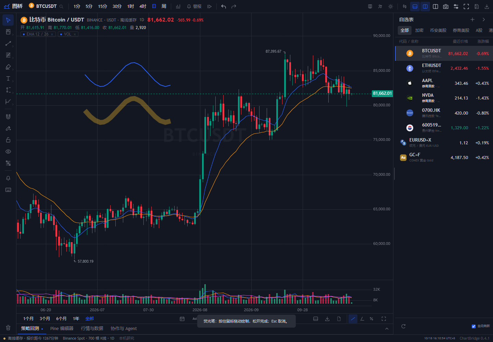

# ChartBridge · 图桥

简体中文 · [English](README.en.md)

想让 Agent 复核一笔计划时，可以把入场、止损和目标价画在同一张 K 线上。图桥把标的、周期、行情来源和绘图一起交给 Agent 读取。你能在图上调整风险预算，看计划数量和盈亏比怎样变化，再把研究批注留在对应的位置。仓位框用于测算，服务没有交易所下单接口。

## 画出第一笔计划

需要 **Node.js 22.19 或更高版本**和 npm。以下命令安装锁定的依赖。启动时会先构建 `dist/`，图表资源随后由本机提供。

```sh
git clone https://github.com/shangchaovo/chartbridge.git
cd chartbridge
npm ci --ignore-scripts --no-fund --no-audit
npm start
```

1. 打开 [本机工作台](http://127.0.0.1:18765/)，在自选或搜索中选择标的和周期。先看行情的来源、时间和缓存标记。
2. 在绘图工具中选择「多头仓位」或「空头仓位」，在主图放置仓位框。拖动手柄调整入场、止损与止盈；双击仓位框设置风险预算、费用和滑点，查看估算数量、风险金额与盈亏比。[仓位操作与计算口径](docs/position-planning-and-audit.md)
3. 想让 Agent 复核时，打开「协作与 Agent」。共享图表包含当前标的、周期、绘图和批注，连接步骤见下文。



截图使用缓存的历史行情和演示绘图。界面和专题文档以中文为主。

## 工作台能做哪些研究

| 任务 | 操作与限制 |
| --- | --- |
| 对比走势 | 支持蜡烛、空心蜡烛、OHLC、折线、面积图和双图对照。周期为 `1m`、`5m`、`15m`、`30m`、`1h`、`4h`、`1d`、`1w`。可分页加载历史、切时区、定位日期和查看收盘倒计时，可用历史和延迟取决于行情源。 |
| 记录判断 | 37 种绘图工具覆盖线条、通道、斐波那契、路径、弧线、画笔、荧光笔和测量。可收藏工具、编辑样式与坐标、管理层级、锁定、撤销或重做。锚定 VWAP、回归通道和固定区间量能分布可直接叠加；量能分布由 K 线估算。 |
| 比较计划 | 多空框支持分别调整价位与宽度，按风险预算、合约乘数、费用和滑点估算数量及保证金。计划可保存和导出，账户持仓与实际成本对照仍属路线图。 |
| 回放与回测 | 支持逐根历史回放、实验性 Pine v5/v6 子集和基础 EMA、RSI、买入持有策略。基础回测在收盘产生信号，下一根开盘成交，计入费用和滑点，采用全仓做多或空仓模型。 |
| 延续上次研究 | 自选有备份与恢复，部分 TradingView 本机自选与设置可导入。支持 CSV、工作区 JSON、图表 PNG；价格触达提醒依赖服务持续运行，可接通知通道。 |

绘图专属参数、跨图同步、更完整的交易日历、期货换月和撮合规则仍有覆盖差异。图表基于 KLineCharts，脚本执行基于 PineTS，兼容范围见 [功能对照与已知缺口](docs/feature-audit-2026-10-18.md)。

## 让 Agent 读取同一张图

图桥提供 Streamable HTTP MCP，本机默认地址为 `http://127.0.0.1:18765/mcp`。独立 MCP 客户端可在主机页面「协作与 Agent → 局域网连接凭据」取得对应角色的凭据，使用 `Authorization: Bearer <凭据>` 请求头连接。示例程序使用 `CHARTBRIDGE_URL`（服务根地址）和 `CHARTBRIDGE_TOKEN` 环境变量。

```sh
node scripts/agent-example.mjs
node scripts/agent-example.mjs --research indicators
node scripts/agent-example.mjs --research backtest
```

第一条返回共享房间、图表版本、标的、周期和行情，后两条分别计算指标与基础回测。只读凭据足以完成这三步。写入研究批注需要编辑权限，并在示例命令末尾添加 `--share-research`。写入会核对图表版本；发生冲突时先读取新版，界面可保留冲突草稿。[Agent 接口与计算口径](docs/agent-research.md)

## 行情、存储与共享

- 加密行情来自 Binance、OKX、Kraken 等公开接口，其他市场使用新浪、Yahoo 等来源。上游不可达时可读取已有历史缓存，图上保留来源和时间。Binance 黄金永续、PAXG 现货各有自己的品种，Pyth Pro 黄金历史需另行授权。[行情来源](docs/lan-and-live.md) · [黄金与 Pyth](docs/pyth-and-symbol-icons.md)
- 默认仅监听本机。需要私网协作时运行 `npm run start:lan`。普通私网客户端使用读者或编辑凭据，程序认定为受信任的 Tailscale 连接可获得 owner 权限；共享范围取决于网络访问控制。仅在可信私网使用，凭据放入客户端配置，避免写入链接。[私网访问说明](docs/lan-and-live.md)
- 工作区、共享图表数据库、凭据与行情缓存默认存于 `data/`。备份前先停止服务，再复制该目录。模型、通知和授权行情请求会发往所配置的服务。原「山海 / Shanhai Terminal」的本机存储标识和 `SHANHAI_*` 配置兼容项继续可用。

Windows 可用 `start-local-windows.cmd` 打开本机模式，`start-windows.cmd` 用于私网模式。macOS 也保留「启动山海」启动器。开发使用 `npm run dev`，单独构建用 `npm run build`，测试用 `npm test`。脚本定义见 [package.json](package.json)。

[收藏绘图工具栏](docs/drawing-favorites-2026-10-20.md) · [自选恢复](docs/watchlist-persistence-2026-10-20.md) · [公开功能研究与证据边界](docs/rea-research.md)

## 许可证

项目采用 [AGPL-3.0-only](LICENSE)。KLineCharts 使用 Apache-2.0，PineTS 使用 AGPL-3.0-only。完整声明见 [第三方声明](THIRD_PARTY_NOTICES.md) 和 [许可证文本](licenses/)。品牌图标、外部行情及其再分发权按各自的条款处理。
