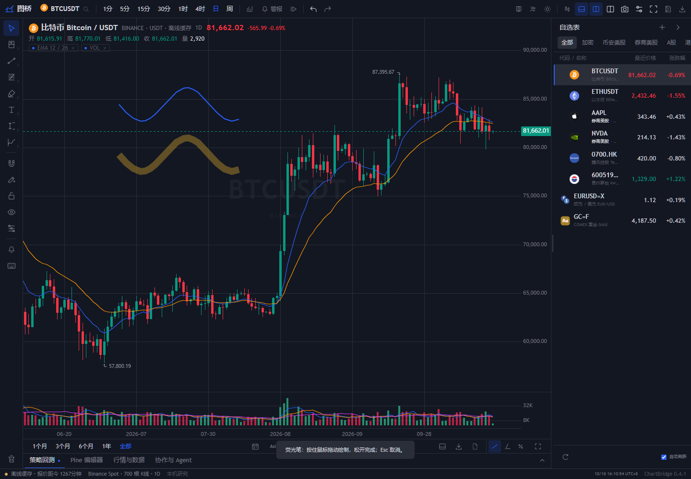

# ChartBridge · 图桥

**让人和 AI Agent 在同一张图上研究市场。**

简体中文 · [English](README.en.md)

ChartBridge 是一个本地运行的交易研究工作台，把真实行情、图表、绘图、交易计划和 Agent 协作放在同一个工作区。你在图上标出判断，Agent 通过结构化接口读取上下文、计算指标，并把研究结果写回图表，减少截图搬运和重复解释。

> 图桥连接的是「行情 → 图表 → 交易意图 → Agent」。当前提供研究与计划测算，没有交易所下单接口。界面目前以中文为主；本仓库提供中英双语首页。



*截图使用本地缓存的真实历史行情与演示绘图，不代表实时价格或交易建议。*

## 为什么做图桥

交易研究经常跨越几处：图表软件里分析，交易所里看持仓，聊天窗口里让 Agent 帮忙。图上的计划和账户里的实际状态难以对齐，每次又要重复截图、解释标的与周期、说明自己的判断。

图桥围绕三件事展开：

1. **让图表成为共同上下文。** 人与 Agent 读取同一标的、周期、行情、绘图和批注。
2. **把判断留在图上。** 入场、止损、止盈和风险预算成为可以保存、调整、计算的交易计划。
3. **把持仓与意图接起来。** 后续接入本地持仓、成本和账户状态，让研究能够对照实际仓位。这部分仍是路线图，尚未完成。

## 当前功能

| 范围 | 已实现内容 |
| --- | --- |
| 行情与自选 | 多市场公开 OHLCV、搜索与自选、交易所/来源区分、本地图标、历史分页与缓存、来源时间和延迟提示 |
| 图表与导航 | 蜡烛、空心蜡烛、OHLC、纯折线与面积图；8 个周期；双图对照；价格轴缩放；时区与日期定位；K 线收盘倒计时 |
| 绘图与管理 | 32 种工具，含线条、通道、斐波那契、几何、文字、区间测量、画笔和半透明荧光笔；样式/坐标编辑、对象管理、显隐、锁定、层级、撤销与重做 |
| 仓位计划 | 多头/空头框，独立调整入场、止盈、止损和宽度；按风险预算计算数量；费用、滑点、乘数与保证金估算；保存与导出 |
| 量价分析 | 锚定 VWAP、线性回归通道和固定区间量能分布；量能分布明确标为 K 线估算 |
| 脚本与回测 | 实验性 Pine v5/v6 编辑器、技术指标、历史逐根回放；EMA、RSI 和买入持有基础回测，包含费用、滑点和交易记录 |
| Agent 与协作 | Streamable HTTP MCP；读取行情、图表和绘图；计算指标/基础回测；用编辑凭据写回绘图与锚定批注；保留冲突草稿 |
| 提醒与导入导出 | 服务运行期间后台检查价格触达提醒；可配置通知通道；CSV、JSON 工作区与 PNG 图表导出；从本机 TradingView 配置导入部分自选与设置 |

支持的周期为 `1m`、`5m`、`15m`、`30m`、`1h`、`4h`、`1d`、`1w`，实际可用范围取决于行情源。详细完成度和差异见[功能对照清单](docs/feature-audit-2026-10-18.md)。

## 快速开始

需要 **Node.js 22.19+** 和 npm；公开行情的可用性取决于网络和上游服务。

```sh
git clone https://github.com/shangchaovo/chartbridge.git
cd chartbridge
npm ci --ignore-scripts --no-fund --no-audit
npm start
```

打开 [http://127.0.0.1:18765/](http://127.0.0.1:18765/)。`npm start` 会先生成本地 `dist/`，默认只监听本机。图表运行资源不依赖远程 CDN。

| 用途 | 命令或入口 |
| --- | --- |
| 本机使用 | `npm start`；Windows 可双击 `start-local-windows.cmd` |
| 开发 | `npm run dev`；后端修改自动重启，前端修改后刷新页面 |
| 私网共享 | `npm run start:lan`；Windows 可双击 `start-windows.cmd` |
| 构建 | `npm run build` |
| 测试 | `npm test` |

macOS / Linux 也可使用上述 npm 命令。仓库中原有的「启动山海」macOS 启动器继续保留，便于已有用户使用。

首次打开后，可从自选或搜索选择标的，切换周期并绘图；多空仓位用于记录计划，「协作与 Agent」提供共享图表连接信息。

## 连接 Agent

MCP 地址为 `http://<主机>:18765/mcp`。在主机的本机页面打开「协作与 Agent → 局域网连接凭据」，将只读或编辑凭据配置到 MCP 客户端的 `Authorization: Bearer <凭据>` 请求头。

- **只读凭据**：查询行情、读取图表、计算指标和基础回测。
- **编辑凭据**：在上述基础上提交绘图和批注；修改需携带图表版本，避免覆盖其他人的新内容。

也可运行无额外依赖的 Node 示例；先在自己的终端设置 `CHARTBRIDGE_URL` 与 `CHARTBRIDGE_TOKEN`：

```sh
node scripts/agent-example.mjs
node scripts/agent-example.mjs --research indicators
node scripts/agent-example.mjs --research backtest
```

这些命令只查询和计算。发布研究批注需使用编辑凭据并显式添加 `--share-research`。配置方式、接口和计算口径见 [Agent 计算与共享图表](docs/agent-research.md)。

## 行情与本机数据

- 加密市场接入 Binance、OKX、Kraken 等公开接口；其他市场使用新浪、Yahoo 等网页行情源。各源的数据覆盖、推送能力、延迟和可用历史不同，接口存在不等于全部品种均可实时获取。
- Binance 黄金永续和 PAXG 现货可作为独立的黄金相关品种；Pyth Pro 黄金历史需要自己的授权。这些来源不会互相冒充或替代。
- 上游失败时可使用已下载缓存，界面保留缓存与时间标记；不生成虚构价格补齐缺口。
- 工作区、共享图表数据库、凭据和缓存保存在未跟踪的 `data/`。备份时先停止服务，再复制这个目录。

更多说明见[行情与局域网](docs/lan-and-live.md)、[黄金来源与 Pyth 授权](docs/pyth-and-symbol-icons.md)。

## 当前边界与路线图

这是一个持续开发中的独立开源项目。当前不具备完整的 TradingView/Pine 兼容性，也不包含其专有图表库或闭源指标源码。

| 方向 | 当前状态与下一步 |
| --- | --- |
| 图表交互 | 继续补齐绘图专属参数、路径/曲线、更多周期和图表类型、多模板与多图同步 |
| 行情语义 | 完善交易日历、午休/夜盘、复权、换月、合约规格和跨源一致性 |
| 持仓与意图 | 计划接入本地持仓、成本和账户上下文；当前仓位框是独立研究计划 |
| 脚本、回测与提醒 | 完善 Pine 子集、复杂绘图和撮合规则，以及指标/画线的高级警报条件 |

独立基础回测以收盘信号在下一根开盘成交，当前主要为全仓做多/空仓，不模拟完整交易所规则。区间量能分布来自 K 线估算，仓位保证金也是计划估算。提醒依赖本机服务运行，不能视为无人值守云端服务。

## 访问与隐私

- 默认只监听 `127.0.0.1`；仅在需要共享时开启私网模式，不要把服务端口直接暴露到公网。
- 私网模式使用 HTTP 和独立访问凭据。请通过可信私网或安全隧道使用，不把凭据放进 URL、截图或仓库。
- 模型密钥、行情授权和通知配置留在本机 `data/` 或环境变量中。行情请求和主动启用的模型/通知请求仍会发往所配置的服务。
- 沿用旧的本机存储键、访问标识和 `SHANHAI_*` 配置兼容项，改名不会要求清空已有图表或个人设置。

## 技术与文档

图表由 **KLineCharts** 渲染，实验性 Pine 执行使用 **PineTS**；Node.js 服务负责行情适配、历史缓存、共享状态和 MCP。REA 仅用于独立研究，不是运行依赖。

- [功能对照、验收和剩余缺口](docs/feature-audit-2026-10-18.md)
- [多空仓位的使用与计算口径](docs/position-planning-and-audit.md)
- [Agent 计算与共享图表](docs/agent-research.md)
- [行情来源与私网使用](docs/lan-and-live.md)
- [REA 调查与证据边界](docs/rea-research.md)

以上专题文档目前主要为中文。项目原名「山海 / Shanhai Terminal」，现更名为 **ChartBridge · 图桥**。

## 许可证

项目采用 [AGPL-3.0-only](LICENSE)。KLineCharts 为 Apache-2.0，PineTS 为 AGPL-3.0-only；完整说明见 [THIRD_PARTY_NOTICES.md](THIRD_PARTY_NOTICES.md) 与 `licenses/`。

品牌图标和外部行情保留各自的权利与使用条款，项目的软件许可证不授予行情再分发权。
